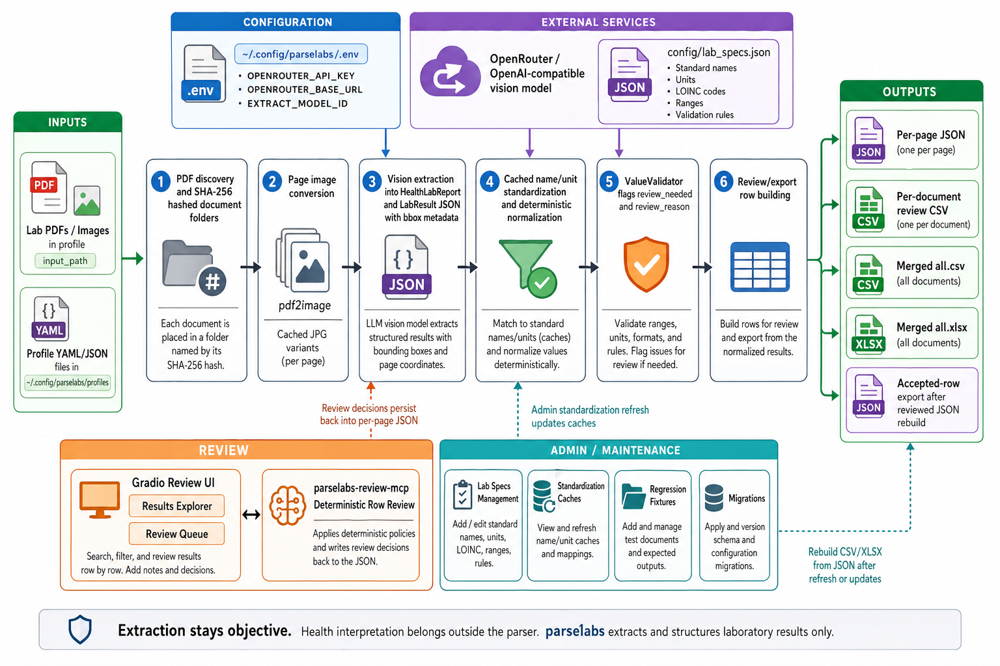

<p align="center">
  
  <br />
  <!-- repo-tagline:start -->
  <strong>🔬 Extract structured lab results from medical PDFs 📊</strong>
  <!-- repo-tagline:end -->
</p>

parselabs is a Python CLI for turning lab-report PDFs and images into structured review data. It converts pages to images, extracts objective lab results with an OpenRouter-compatible vision model, standardizes names and units, validates suspicious values, and writes CSV/XLSX outputs.

The parser keeps extraction objective. Review decisions, fixture promotion, and health interpretation happen outside the extraction model through the review UI and admin tooling.

Normalization preserves reported text, comparison signs and assay-unit calibration. Separately printed percentages, absolute counts and cell ratios remain distinct observations; unsupported unit conversions retain the source scale, including unusual printed MCHC percentages and reticulocyte hemoglobin `pg/L` units.

## Install

Requirements:

- Python 3.10+
- [uv](https://docs.astral.sh/uv/)
- Poppler for PDF conversion

```bash
git clone https://github.com/tsilva/parselabs.git
cd parselabs
uv tool install . --editable
```

On macOS, install Poppler with:

```bash
brew install poppler
```

Create shared runtime settings:

```bash
mkdir -p ~/.config/parselabs/profiles

cat > ~/.config/parselabs/.env <<'EOF'
AGENTBRIDGE_API_KEY=your_key_here
# Optional:
# AGENTBRIDGE_BASE_URL=http://127.0.0.1:8082/api/v1
EXTRACT_MODEL_ID=google/gemini-2.5-pro
EOF
```

Create a profile:

```bash
cp profiles/template.yaml.example ~/.config/parselabs/profiles/myname.yaml
```

Edit the copied input/output paths before running extraction.

Run extraction:

```bash
parselabs --profile myname
```

Open the review workspace with:

```bash
parselabs review --profile myname
parselabs review --profile myname --tab review
```

The light Svelte dashboard has two screens. **Results** shows one lab's trend and history, with status filtering, CSV export, and **View report** links. **Review** shows the pending queue, source page with the selected result highlighted, and Accept/Reject controls. Undo, missing-row markers, and extraction details are in the overflow menu. Keyboard shortcuts are `Y`/`N` for decisions, `J`/`K` or arrow keys for navigation, `U` for undo, and `M` for a missing row.

Decisions persist to the existing page JSON. Results use standardized values; the review inspector shows the original extracted value, unit, and reference range for checking against the page. The server binds to loopback and serves only the selected profile's output. The compiled frontend is bundled, so running the dashboard does not require Node.js.

### Dashboard development

The Svelte source is in `frontend/`. Use Node.js 22.18+ and pnpm 10:

```bash
cd frontend
pnpm install --frozen-lockfile
pnpm check
pnpm build                 # writes the bundled frontend to static/dashboard/
pnpm dev -- --port auto    # prints the available preview URL
```

Start `parselabs review --profile myname` separately to provide the API at port 7862. For an isolated synthetic preview, run `uv run python frontend/scripts/demo.py` from the repository root instead; its generated reports and caches stay outside the repository and real profiles. If the API uses another port, set `PARSELABS_API_URL` when starting the frontend. Rebuild and include `static/dashboard/` whenever the frontend changes; these assets also ship in the Python wheel.

## Profile templates and private configuration

Copy the tracked [profile template](profiles/template.yaml.example) to
`~/.config/parselabs/profiles/myprofile.yaml`, then edit that private copy. The
example records supported configuration without storing anyone's real identity,
source paths, goals or account bindings. Keep `.config/` and live profiles ignored;
back up the external files independently. Shared rules belong in repository code,
documentation and synthetic tests; machine-specific settings remain runtime overrides.

### Optional shared-folder routing

When source folders contain both labs and medical exams, a filename convention
can keep automatic discovery separate. Label lab PDFs `analises.pdf` or
`YYYY-MM-DD - analises - description.pdf` and other exams with their exam name.
Selection is case-insensitive and recursive. This is a naming convention, not
clinical document classification; verify the filenames before adopting it.

In parselabs, `paths.input_file_regex: "*analises*.pdf"` is a **glob**. In
parsemedicalexams, `input_file_regex` is a **regular expression**:

```yaml
input_file_regex: '^(?!(?:\d{4}-\d{2}-\d{2}\s*-\s*)?analises(?:\s|[-.]|$)).*\.pdf$'
```

The exam expression excludes a leading `analises` label, optionally after an ISO
date. The lab glob also matches that word elsewhere, so arbitrary filenames are
not guaranteed to form a disjoint partition. Lab discovery additionally excludes
explicitly labelled `receita`, `pedido exame` and `bula` documents. An explicit
parsemedicalexams `--document` request bypasses its automatic filename filter.
Keep existing profile overrides; neither parser's all-PDF default changes.

## Local profile shortcuts

To browse external profiles from this checkout, create the following local
shortcuts after configuring the runtime profiles:

```bash
mkdir -p .config
ln -s "$HOME/.config/parselabs/profiles" .config/profiles
```

`.config/profiles` is a directory symlink to
`~/.config/parselabs/profiles/`. New profiles in that external directory appear
through the shortcut automatically. Keep that external directory limited to
profile files; do not put credentials or other runtime state there.

The entire repo `.config/` directory is Git-ignored. Actual profile files stay
outside the checkout; editing through a shortcut edits the original, and the
link is not a read-only view or a backup. Git cleanup can remove the local
shortcut without deleting its external target. Recreate shortcuts after cloning
or cleanup, and back up the external profiles independently. Shared `.env`
files, credential stores, sessions, databases, caches, logs and parser outputs
remain outside these shortcuts. Runtime discovery paths and CLI behavior are
unchanged.

## Commands

```bash
parselabs                                  # run extraction for all profiles
parselabs --profile myname                 # run one profile
parselabs extract --profile myname         # explicit extraction command
parselabs --list-profiles                  # list configured profiles
parselabs --profile myname --model MODEL   # override extraction model
parselabs --profile myname --pattern "*.pdf"
parselabs --profile myname --rebuild-from-json

parselabs review --profile myname          # launch Results Explorer on port 7862
parselabs review --profile myname --tab review

parselabs admin --help
parselabs admin validate-lab-specs
parselabs admin update-standardization-caches --profile myname
parselabs admin update-standardization-caches --profile myname --name-batch-size 40 --unit-batch-size 40
parselabs admin regression sync-reviewed --profile myname

uv run python test.py --profile myname     # data integrity checks for one profile
uv run python test.py                      # data integrity checks for all profiles
make regression-quick                     # curated local PDFs re-parsed through AgentBridge
make regression-quick-offline             # same curated cases, saved-JSON replay only
make regression-full-offline              # complete local golden corpus
RUN_LOCAL_GOLDENS=1 uv run pytest -m golden_local
RUN_APPROVED_DOCS=1 uv run pytest -m approved_docs # opt-in re-extraction through configured API
```

The medical golden corpus stays local at `~/.local/share/parselabs/approved/`, outside Git and cloud-synced profile outputs. Never commit or upload its PDFs, reviewed JSON, expected CSVs, review notes, logs, or screenshots. `PARSELABS_APPROVED_FIXTURES_DIR` can select another private local location; paths inside Git checkouts are rejected. Generic test code and synthetic fixtures may be versioned.

Before promotion, inspect every source page and row crop, confirm patient identity and dates, check omissions, and independently validate normalized values, units, intervals, limit flags, and deduplication. Resolve pending rows and missing-row markers, then record that completed audit with `parselabs admin regression attest-reviewed --profile myname --source-file "document.pdf" --review-note "Evidence and outcome of the completed audit"`. This command records the review; it does not perform it. Promote selected documents with `parselabs admin regression sync-reviewed --profile myname --source-file "document.pdf"` (repeat `--source-file` for multiple documents). When different PDFs share a filename, use `--document-key "document_01234567"` with the exact processed-directory name for either command; filename selection rejects ambiguity. The corpus keeps each profile/stem/hash identity separately. Promotion rejects stale PDF/page hashes or changed normalized output. Existing baselines require `--replace` when their content changes; unrelated cases are preserved.

`RUN_LOCAL_GOLDENS=1` replays frozen reviewed JSON through normalization and export entirely locally, without extraction API calls. It does not rerun vision extraction. Both private test modes are skipped in ordinary pytest/CI runs and fail if explicitly enabled without a corpus. See [the regression workflow](utils/README.md#local-medical-golden-corpus) for corpus contents and validation details.

## Notes

Use `make regression-quick` after significant changes to extraction, prompts, model routing, normalization or exports. It re-parses a curated sample through the configured AgentBridge model. The private selection is stored in `~/.local/share/parselabs/quick-suite.json`, beside the approved corpus; it records source hashes, layout coverage, required profiles and document/page budgets. Missing cases, changed PDFs or lost profile coverage fail instead of silently selecting fewer documents. Neither real documents nor their selection manifest belong in Git. Both private test modes refuse to run in CI even when explicitly enabled. No scheduled job or Git hook is installed.

Fresh regression matches reviewed observations by page and content before applying saved review decisions, then compares dates, assays, measurements, units, reference bounds and limit flags. Changed row order, raw numeric formatting and sentence-ending punctuation do not alone fail the fresh comparison; missing or extra observations and substantive differences do. Outputs, logs and `latest-result.json` remain privately under the corpus's sibling `regression-runs/` for investigation. Model latency determines runtime; saved-parse replay is the faster deterministic check. Failures never automatically update approved goldens.

Extraction preserves inline units even when they conflict with a shared heading; contradictory source rows require review rather than an inferred correction. Explicitly labelled normal/control PT and APTT measurements are excluded as laboratory controls, while patient results remain. Registration/episode dates in older report headers stay separate from report and print dates. Unit-cache lookup tolerates wrapped whitespace, accented count labels and equivalent micro symbols, without changing the stored raw text or unit scale.

- Profiles live in `~/.config/parselabs/profiles/` as YAML or JSON. Shared runtime settings live in `~/.config/parselabs/.env`; shell environment variables take precedence.
- `EXTRACT_MODEL_ID` selects the extraction model; `AGENTBRIDGE_API_KEY` is optional gateway authentication. `AGENTBRIDGE_BASE_URL` defaults to `http://127.0.0.1:8082/api/v1`.
- To use local AgentBridge, set `AGENTBRIDGE_BASE_URL=http://127.0.0.1:8082/api/v1` and `EXTRACT_MODEL_ID=codex/gpt-6.1-sol`. Validation, extraction, and name/unit standardization explicitly request high reasoning effort for Sol. The startup validation allows 120 seconds for model startup and queueing, with SDK retries disabled to avoid duplicate queued work.
- Each processed PDF gets a hashed output directory containing the copied source PDF, cached page JPGs, per-page JSON, and a per-document review CSV.
- Page JSON is the durable source of truth. Per-document CSVs, `all.csv`, and `all.xlsx` are rebuilt from JSON and review state.
- Exports keep numeric measurements in `value` and reported qualitative/interval text in `value_text`. Text results can legitimately have an empty numeric `value`; no count or concentration is invented. Color and appearance use the `text` scale without numeric normality codes. Qualitative ANA/CRP/MPO/PR3/thyroid-antibody results have separate boolean assay names. Titers use the dilution denominator in `value` with unit `titer`, while `value_text` retains notation such as `<1/80`. Distinct text findings and explicitly numbered source specimens survive deduplication, including equal negative results from separate stool samples.
- ABO group and Rh type retain text results. Unqualified glucose and fasting glucose have separate definitions. Second-hour sedimentation retains its two-hour scale (`mm/(2.h)`); printed distance readings are not relabeled as hourly rates.
- Review UI defaults to the Results Explorer on `http://127.0.0.1:7862`; `--tab review` launches the Review Queue on `http://127.0.0.1:7863`.
- `config/lab_specs.json` contains the bundled standardized lab definitions. Writable standardization-cache overrides live in `~/.config/parselabs/cache/` and fall back to the bundled defaults.
- Tissue/pathology findings use `Tissue - ...` names and `lab_type=tissue`. Diagnoses, immunostain grades and other descriptive findings retain their literal text without inferred normality. Explicit margin distances and regression percentages have separate numeric definitions. Printed superficial and deep margin labels keep those measurements separate during duplicate detection and export. Terms without a verified exact LOINC match remain documented catalog exceptions; no substitute specimen or method code is assigned. See [pathology terminology](docs/pipeline.md#tissue-and-pathology-terminology).
- `parselabs admin` is the preferred entry point for maintenance, lab-spec validation, cache refreshes, reviewed fixture sync, and output migrations.

## Architecture



For a step-by-step description of the current extraction, review, and export pipeline, see [docs/pipeline.md](docs/pipeline.md).

## AgentBridge routing

Model requests use only AgentBridge. Set `AGENTBRIDGE_BASE_URL` to its API root
(default `http://127.0.0.1:8082/api/v1`). `AGENTBRIDGE_API_KEY` is an optional
gateway token. OpenRouter credentials belong to AgentBridge. Existing model
choices are retained; raw upstream IDs gain `openrouter/` only on outbound
requests. There is no direct OpenRouter endpoint or fallback. Hosted deployments
must configure a reachable AgentBridge URL instead of the loopback default.

## Extraction fidelity

Lab discovery scans nested source folders and excludes explicitly labelled prescriptions, exam orders and leaflets. Extraction records a printed patient header when available and rejects incompatible headers against the selected profile name; missing headers remain unverified. Collection dates are preserved per page, with report dates and then document/filename dates used only as fallbacks. Percentage references copied from absolute-count sibling columns are flagged for source review, including one-sided intervals and cases where the absolute sibling has no extracted interval. The guard never assigns a replacement without source review. Reticulocyte counts support `/mmc`, `/mm3`, `/mm³` and cells/µL conversions, including reference bounds.

Date extraction keeps specimen collection, laboratory registration/entry and report issue dates separate. A continuation page lacking an event date inherits an explicit collection/registration date from the document before using its report issue date. Explicit different page event dates remain distinct. A result-level `collection_date` preserves separately dated specimens on the same page and overrides the page date only for that result. Reports with unverifiable dates stay out of the validated local corpus.

Reported numeric intervals remain in `value_text` with an empty numeric `value`; no midpoint is invented. Explicit sediment per-volume units override cached per-field mappings. Source rows with conflicting per-field and per-volume labels require review.

Assay mappings preserve printed specificity and methods: deamidated gliadin IgA/IgG differ from generic gliadin antibodies, and HbA2 by HPLC differs from electrophoresis. Quantitative urinary hemoglobin retains its concentration scale. Literal Anti-HBs IU/mL converts to mIU/mL with a factor of 1000; omitted milli-prefixes are never assumed. Colony counts reported in thousands per mL retain that factor. Attached reference tables may establish result units when explicitly linked by the report; unidentified assays remain rejected.

## License

[MIT](LICENSE)
